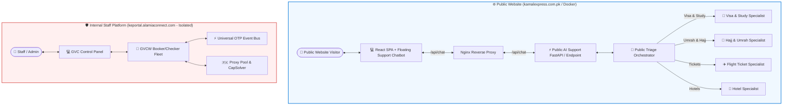

# 🏗️ Architecture & Plan: Public AI Support Agents Integration

## 📌 Executive Summary

The **Kamal Express AI ecosystem** consists of two distinct domain layers:

1. **Internal Staff Automation & Fleet Engine** (`KamalExpress-Agents`):
   - **GVCW Booker & Checker Workers** (`booker.py`, `checker.py`, `standalone_workers/`).
   - **Multi-Account Fleet Manager & Proxy Pool Engine**.
   - **OTP SMS Webhook (`/api/otp/webhook`) & Captcha Solvers**.
   - *Security Requirement*: **MUST remain strictly internal** on staff portal (`keportal.alamiaconnect.com`) and never be exposed on the public website.

2. **Public Customer AI Support Microservice**:
   - **Public AI Support Agents**: Specialized LLM conversational agents for **Visa Requirements**, **Study Visas**, **Hajj & Umrah Packages**, **Flight Tickets**, and **Hotel & Transport**.
   - *Public Requirement*: Embed an interactive floating **AI Customer Assistant Chatbot** on the public React website (`kamalexpress.com.pk`) to assist end users 24/7.

---

## 📐 System Architecture Diagram

---

## 🔍 Module Classification & Security Boundaries

| Module / Component | Target Environment | Rationale & Security Boundary |
| :--- | :--- | :--- |
| **Visa Agent** (`agents/visa`) | 🟢 Public Website | Provides visa rules, document checklists, and application steps for clients. |
| **Umrah Agent** (`agents/umrah`) | 🟢 Public Website | Assists clients with Umrah packages, Nusuk permits, and Ziyarat details. |
| **Ticket & Study Agent** | 🟢 Public Website | Guides students on study visas and travelers on flight ticket inquiries. |
| **Hotel Agent** (`agents/hotels`) | 🟢 Public Website | Provides information on Makkah/Madinah hotels and accommodations. |
| **GVCW Booker** (`booker.py`) | 🔴 Internal Only | Automated slot booking on Greek GVC portal (contains sensitive GVC credentials). |
| **GVCW Checker** (`checker.py`) | 🔴 Internal Only | Slot monitoring background worker for Greece VACs. |
| **Fleet Manager & OTP Webhook** | 🔴 Internal Only | Manages SIM SMS OTP forwarding and client credential queues. |
| **Proxy Pool Engine** | 🔴 Internal Only | Pakistan residential proxy pool management. |

---

## 🛠️ Step-by-Step Implementation Plan

### Phase 1: AI Support Agent Service Container (`ai-support`)
1. Extract and package the public AI agents (Visa, Umrah, Ticket, Study, Hotel, Triage Orchestrator) into a lightweight FastAPI service inside the Docker setup.
2. Configure LLM provider credentials (`OPENAI_API_KEY` / `GEMINI_API_KEY` / `GROQ_API_KEY`) via environment variables in `docker-compose.yml`.
3. Expose only the `/api/chat` streaming/JSON endpoint for customer support inquiries.

### Phase 2: React Customer Chatbot Widget
1. Create a modern floating **AI Customer Assistant Widget** (`frontend/src/components/AiSupportChat.tsx`) with:
   - Floating chat trigger pill with Lucide icons (`BotMessageSquare`, `Sparkles`).
   - Quick prompt pills (*"Visa Checklist for Greece"*, *"Umrah Packages 2026"*, *"Study Visa Steps"*, *"Flight Ticket Inquiry"*).
   - Real-time response streaming and Markdown response formatting.

### Phase 3: Nginx & Docker Integration
1. Update `docker-compose.yml` to include the `ai-support` service container connected to the internal Docker network.
2. Update `nginx.conf` to proxy `/api/chat` to `http://ai-support:8000/chat`.
3. Ensure no internal GVCW endpoints (`/api/otp/*`, `/api/fleet/*`, `/api/proxy/*`) are routed by Nginx on the public website container.

---

## ❓ Alignment Questions for User

1. **LLM Provider Preference**: Which LLM provider would you like the public chatbot to use (e.g. OpenAI GPT-4o / GPT-4o-mini, Google Gemini 2.0 Flash, or Groq / Ollama)?
2. **Contact Escalation**: When the AI chatbot cannot answer a specific user query, should it auto-open the website Inquiry / Contact form or provide Kamal Express WhatsApp support number (`+92...`)?
3. **Docker Integration**: Shall we proceed now with setting up the `ai-support` service container and floating React chat widget in `live-website` branch?
