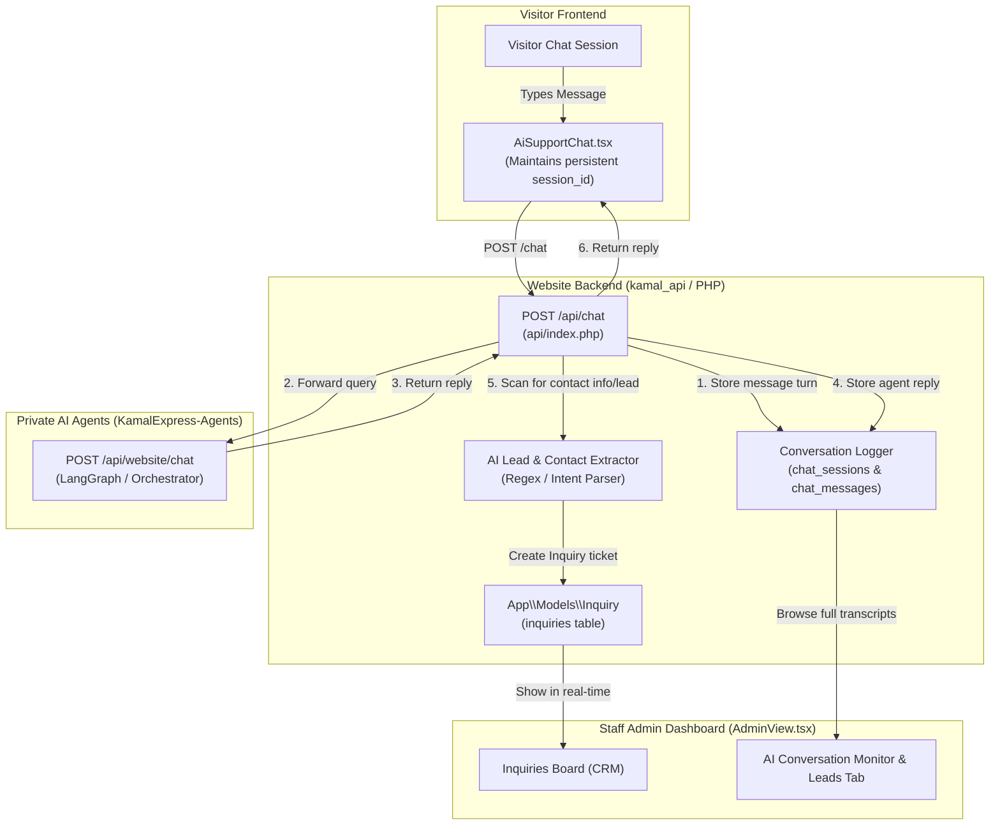

# Architecture & Implementation Plan: Unified Conversation Logging & In-House CRM Lead Capture

This plan leverages the **in-house CRM and CMS** already present in this repository (`kamal-express-website`), connecting the AI Support Agent conversations directly into our CRM database tables and Staff Admin Panel.

---

## 1. System Overview



---

## 2. In-House CRM Integration: How Leads are Captured

The existing CRM already manages customer inquiries in the **`inquiries`** table (`App\Models\Inquiry`):
* `reference_id`: Unique ticket identifier (e.g. `KE-2026-XXXX`).
* `name`, `email`, `phone`: Client contact details.
* `service_type`: Visa Consultancy, Umrah, Air Ticketing, Hotel Reservations, etc.
* `destination`: Destination country (e.g. China, Greece, UK, Saudi Arabia).
* `notes`: Lead summary and user requirements.
* `status`: `Pending`, `Contacted`, `Closed`.

### 2.1 Lead Capture Mechanisms:
1. **Explicit Escalation Action (Already built in `AiSupportChat.tsx`)**:
   - The AI support widget displays an **"Submit Official Inquiry"** action button. Clicking it prefills the contact modal and submits to `POST /inquiry`.
2. **Automatic Turn-by-Turn Lead Capture (New)**:
   - When a visitor converses with the AI agent and provides contact information (e.g. *"my phone is 03001234567"* or *"reach me on ali@gmail.com for China study"*):
   - The backend `POST /chat` controller runs an extractor on the conversation history.
   - When phone/email and travel intent are identified, it automatically creates or links an `Inquiry` lead in the CRM marked with `service_type='AI Chat Lead'`.
   - The `reference_id` is linked to the `chat_session`, showing up instantly on the **Admin Inquiries Board**.

---

## 3. Database Schema Design (Auto-Migrated in MySQL)

### 3.1 Table: `chat_sessions`
Tracks visitor conversation threads and links directly to CRM inquiries:
```sql
CREATE TABLE IF NOT EXISTS `chat_sessions` (
    `id` BIGINT AUTO_INCREMENT PRIMARY KEY,
    `session_id` VARCHAR(64) NOT NULL UNIQUE,
    `visitor_name` VARCHAR(100) NULL,
    `visitor_phone` VARCHAR(50) NULL,
    `visitor_email` VARCHAR(100) NULL,
    `detected_service` VARCHAR(100) NULL,
    `detected_destination` VARCHAR(100) NULL,
    `inquiry_id` INT NULL, -- Foreign key linking to inquiries.id once converted
    `status` ENUM('active', 'converted_lead', 'abandoned', 'closed') DEFAULT 'active',
    `message_count` INT DEFAULT 0,
    `ip_address` VARCHAR(45) NULL,
    `user_agent` TEXT NULL,
    `created_at` TIMESTAMP DEFAULT CURRENT_TIMESTAMP,
    `updated_at` TIMESTAMP DEFAULT CURRENT_TIMESTAMP ON UPDATE CURRENT_TIMESTAMP,
    INDEX `idx_session_id` (`session_id`),
    INDEX `idx_inquiry_id` (`inquiry_id`)
) ENGINE=InnoDB DEFAULT CHARSET=utf8mb4 COLLATE=utf8mb4_unicode_ci;
```

### 3.2 Table: `chat_messages`
Stores verbatim messages from both the user and the support agents:
```sql
CREATE TABLE IF NOT EXISTS `chat_messages` (
    `id` BIGINT AUTO_INCREMENT PRIMARY KEY,
    `session_id` VARCHAR(64) NOT NULL,
    `role` ENUM('user', 'assistant', 'system') NOT NULL,
    `content` TEXT NOT NULL,
    `agent_name` VARCHAR(50) DEFAULT 'orchestrator',
    `created_at` TIMESTAMP DEFAULT CURRENT_TIMESTAMP,
    INDEX `idx_session_id` (`session_id`),
    INDEX `idx_created_at` (`created_at`)
) ENGINE=InnoDB DEFAULT CHARSET=utf8mb4 COLLATE=utf8mb4_unicode_ci;
```

---

## 4. Eloquent Models to Add in `api/src/Models/`

1. **`App\Models\ChatSession`**:
   - Relationship: `hasMany(ChatMessage::class, 'session_id', 'session_id')`
   - Relationship: `belongsTo(Inquiry::class, 'inquiry_id', 'id')`
2. **`App\Models\ChatMessage`**:
   - Relationship: `belongsTo(ChatSession::class, 'session_id', 'session_id')`

---

## 5. Staff CRM Panel (`AdminView.tsx`) Enhancements

We will add an **"AI Chat Transcripts"** tab in the sidebar of `AdminView.tsx`:
1. **Conversations List**: Displays recent chats with filters (Active, Converted Leads, Services).
2. **Conversation Drawer/Modal**: Click any conversation to view the full dialogue transcript between the visitor and the AI agent.
3. **One-Click Convert**: If a visitor left an inquiry in chat, staff can click **"Convert to Lead Ticket"**, which instantly adds them to the CRM `Inquiries Board`.

---

## 6. Execution Steps

1. **Database Schema**: Add `chat_sessions` and `chat_messages` table migrations to `api/index.php`.
2. **Models**: Create `ChatSession.php` and `ChatMessage.php` in `api/src/Models/`.
3. **API Logging & Lead Extraction**:
   - Update `POST /chat` in `api/index.php` to persist user messages, assistant responses, and extract leads.
   - Add admin endpoints (`GET /admin/chats`, `GET /admin/chats/{sessionId}`).
4. **Frontend Session**: Ensure `AiSupportChat.tsx` maintains a persistent `session_id` in `localStorage`.
5. **Staff UI**: Add the **AI Conversations** view inside `AdminView.tsx`.
6. **Deploy**: Build frontend, commit, push to GitHub, and deploy to Portainer stack.
